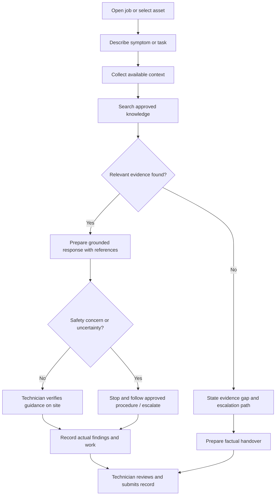
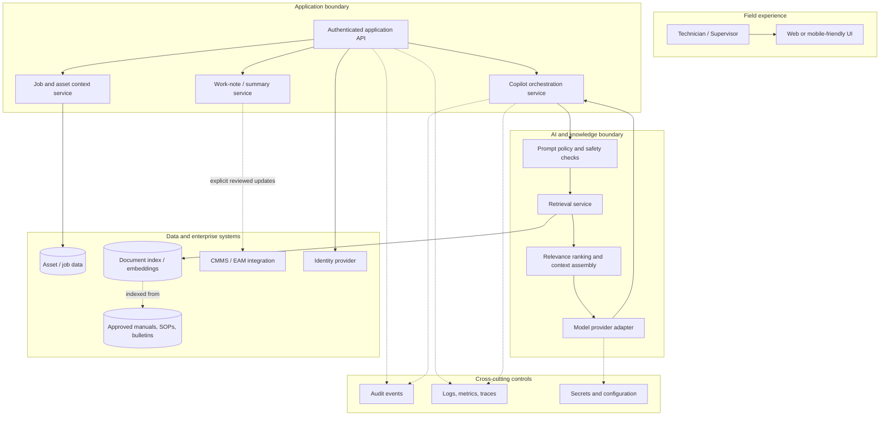
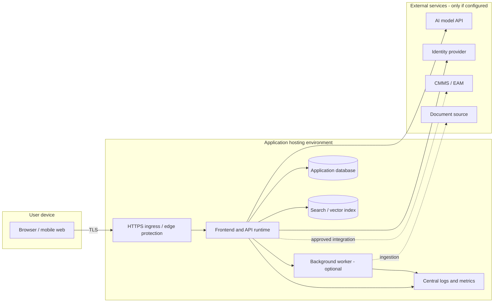
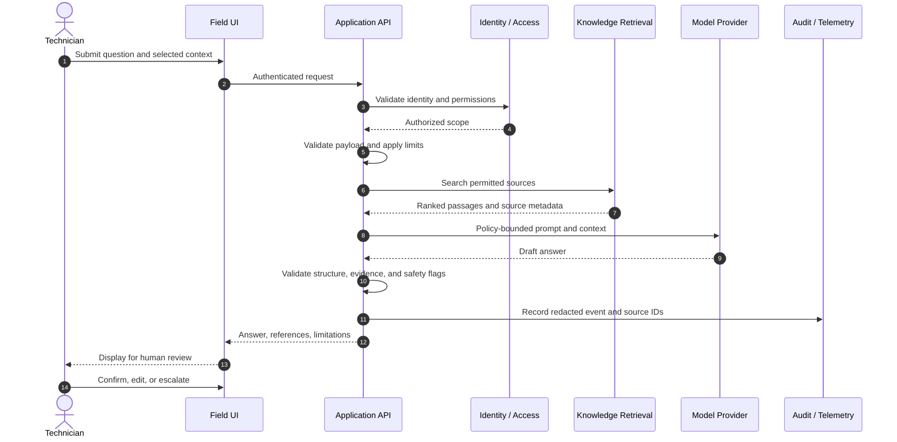
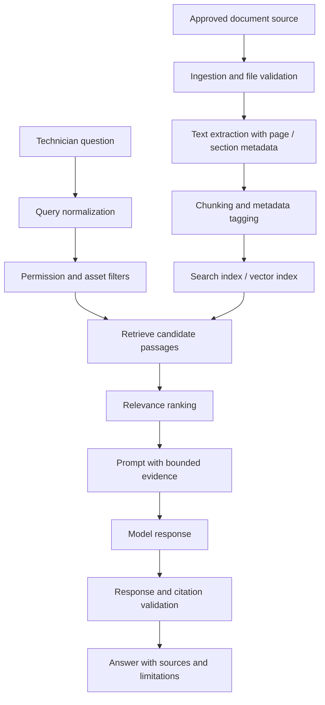
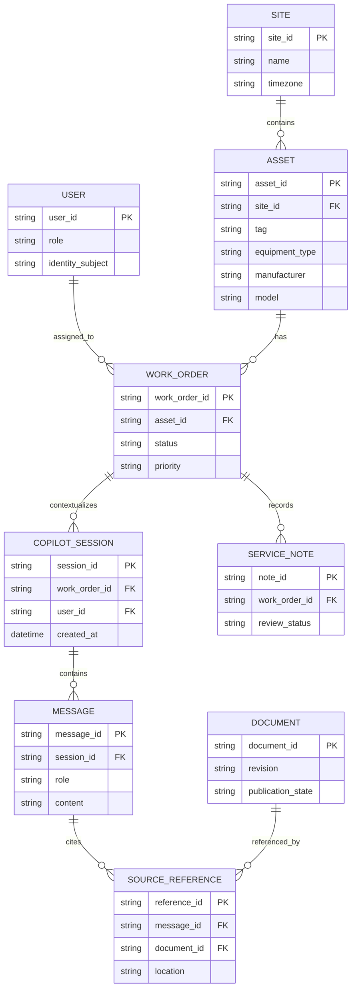
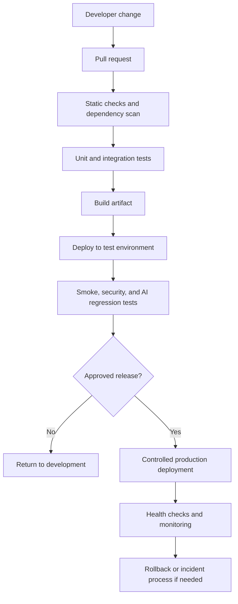

# GridPulse — AI Copilot for Field Technicians

> **An AI-assisted field-service experience for helping technicians find relevant equipment information, work through troubleshooting steps, and capture clearer service outcomes.**
>

<p align="center">
  <a href="https://github.com/lucylow/GridPulse-AI-Copilot-for-Field-Technicians">GitHub repository</a>
  ·
  <a href="https://grid-pulse-copilot-mvp--virtualvegas702.replit.app/">Live prototype</a>
  ·
  <a href="https://canva.link/cgehqgif9epxcnp">Project presentation</a>
</p>

---

## Table of contents

1. [Project at a glance](#1-project-at-a-glance)
2. [The field-service problem](#2-the-field-service-problem)
3. [Product goals and operating principles](#3-product-goals-and-operating-principles)
4. [People and core workflows](#4-people-and-core-workflows)
5. [Conceptual system architecture](#5-conceptual-system-architecture)
6. [AI request lifecycle and knowledge retrieval](#6-ai-request-lifecycle-and-knowledge-retrieval)
7. [Data model and API contract proposals](#7-data-model-and-api-contract-proposals)
8. [Security, privacy, and operational safety](#8-security-privacy-and-operational-safety)
9. [Repository setup and local development](#9-repository-setup-and-local-development)
10. [Testing, observability, and deployment](#10-testing-observability-and-deployment)
11. [Roadmap](#11-roadmap)
12. [Contributing](#12-contributing)
13. [Troubleshooting and FAQ](#13-troubleshooting-and-faq)
14. [Project status and verification checklist](#14-project-status-and-verification-checklist)

---

## 1. Project at a glance

**GridPulse** is positioned as an AI copilot for people who maintain, inspect, and troubleshoot field equipment. The intended experience is to make relevant technical knowledge easier to find at the point of work, organize a troubleshooting session, and help turn field observations into structured service notes.

Field technicians often work across multiple sites, asset types, document repositories, and maintenance procedures. The information needed to diagnose an issue may be distributed across equipment manuals, standard operating procedures (SOPs), historical work orders, inspection forms, and the knowledge of experienced colleagues. A copilot can provide a conversational interface to this information while keeping the technician responsible for decisions and actions.

### Intended user experience

1. A technician opens a job or selects an asset.
2. The technician describes the observed symptom, fault code, or inspection finding.
3. The copilot gathers the available context and searches approved reference material.
4. The copilot presents relevant information and a structured set of next checks, with source references where available.
5. The technician validates the information against the approved procedure and site conditions.
6. The technician records the actual findings and work completed in the appropriate system.

This workflow is a **product and architecture target**, not a claim that every step is currently implemented.

### Project links

| Resource | Link |
|---|---|
| Source repository | [lucylow/GridPulse-AI-Copilot-for-Field-Technicians](https://github.com/lucylow/GridPulse-AI-Copilot-for-Field-Technicians) |
| Prototype | [GridPulse Copilot](https://grid-pulse-copilot-mvp--virtualvegas702.replit.app/) |
| Presentation | [Project presentation](https://canva.link/cgehqgif9epxcnp) |

### Documentation scope and accuracy

The publicly visible repository snapshot reviewed for this README contains a short README and an uploaded ZIP archive. The source files inside that archive have not been independently inspected here. Consequently:

- The product description below is based on the repository name and linked prototype context.
- Architecture diagrams are **proposed reference designs** to make the intended system understandable and actionable.
- API routes, JSON objects, environment variables, integrations, and deployment flows are **illustrative contracts**, not verified implementation details.
- The framework, language, database, authentication provider, AI model provider, and package manager should be added only after inspecting the extracted source.

Maintainers should update the implementation-specific sections as the codebase is unpacked and verified.

---

## 2. The field-service problem

### 2.1 Fragmented technical knowledge

A field technician may need to switch between a work-order system, asset register, equipment documentation, spreadsheets, PDF manuals, and messages from subject-matter experts. This context switching can slow down an investigation and makes it harder to see which information applies to the asset in front of the technician.

### 2.2 Inconsistent troubleshooting records

Service notes are frequently written under time pressure. Important details such as the original symptom, operating conditions, measurements, checks performed, parts replaced, and final disposition may be recorded inconsistently. Incomplete records reduce the value of historical maintenance data.

### 2.3 Experience is difficult to scale

Experienced technicians develop practical knowledge about recurring faults and site-specific conditions. When that knowledge remains informal, newer team members may have difficulty finding it. A searchable, curated knowledge layer can make approved guidance easier to discover without treating an AI-generated response as an authoritative procedure.

### 2.4 Information access at the point of work

The technician needs useful information in a field-friendly format: concise steps, clear warnings, equipment context, and references that can be opened and checked. The interface should support quick reading and structured capture rather than force technicians to interpret long, unstructured answers.

### 2.5 Where a copilot can help

| Challenge | Copilot opportunity | Human responsibility |
|---|---|---|
| Finding the right manual | Search approved documents using asset context and natural language | Confirm model, revision, and applicability |
| Understanding a fault description | Summarize relevant reference material and known checks | Verify symptoms and measurements on site |
| Planning an investigation | Organize a sequence of checks from approved guidance | Select and perform only authorized work |
| Writing service notes | Convert technician-provided notes into a structured draft | Review, correct, and submit the record |
| Handover between shifts | Summarize confirmed findings and unresolved questions | Validate the handover and assign ownership |

---

## 3. Product goals and operating principles

### 3.1 Product goals

- **Reduce information friction:** help users locate relevant, approved technical information quickly.
- **Improve consistency:** encourage a repeatable structure for troubleshooting notes and work summaries.
- **Preserve evidence:** distinguish observed facts, retrieved references, and AI-generated suggestions.
- **Support field workflows:** keep the interaction focused, readable, and usable on a laptop or mobile device.
- **Respect existing systems:** integrate with systems of record rather than silently replacing them.
- **Keep people in control:** make the copilot an assistive tool, not an autonomous maintenance authority.

### 3.2 Non-goals and boundaries

The copilot should not be designed or represented as a replacement for:

- Approved operating procedures, equipment manuals, engineering instructions, or site safety rules.
- Qualified personnel, formal approvals, permits, lockout/tagout (LOTO), or required verification steps.
- Protective relays, supervisory control and data acquisition (SCADA), programmable logic controllers (PLCs), or other safety/control systems.
- An organization's CMMS, EAM, asset register, or official work-order system of record.
- Emergency response protocols or an authorized incident command process.

Unless a separately engineered and certified integration explicitly establishes otherwise, the application should be **read-only with respect to operational equipment controls**. It must not issue switching, energization, shutdown, setpoint, or protection-control commands.

### 3.3 Design principles

1. **Ground answers in approved sources.** Prefer retrieved, versioned documents over unsupported model recall.
2. **Show provenance.** Display the title, revision, section, or link for source material when available.
3. **Separate fact from suggestion.** Label user observations, source excerpts, inferred possibilities, and recommended next checks distinctly.
4. **Fail safely.** When evidence is missing, contradictory, or low confidence, say so and direct the user to the responsible expert or approved process.
5. **Minimize data.** Collect only the information needed for the service task and enforce role-appropriate access.
6. **Make actions explicit.** Require review before saving, sending, or changing a work record.

---

## 4. People and core workflows

### 4.1 Primary roles

| Role | Typical needs | Suggested permissions |
|---|---|---|
| Field technician | Asset context, troubleshooting references, job notes | Read assigned job and asset information; draft notes |
| Field supervisor | Work visibility, escalations, quality review | Review team work; approve or return records where policy permits |
| Reliability / engineering specialist | Evidence, recurring patterns, technical documentation | Access relevant technical records and curate approved guidance |
| Knowledge administrator | Document lifecycle, versions, metadata, access groups | Manage indexed knowledge sources and publication status |
| System administrator | Identity, configuration, monitoring, integrations | Manage system configuration; access governed by least privilege |

These are logical roles for the proposed product. Actual authorization must follow the organization's identity provider and access-control model.

### 4.2 Workflow A — ask a troubleshooting question

1. **Select context:** choose a site, asset, or work order when the application provides those records.
2. **Describe the issue:** enter the symptom, observed condition, alarm code, or measurement. Avoid adding unnecessary personal or sensitive data.
3. **Retrieve references:** the service searches material the user is allowed to access.
4. **Review the response:** the interface displays a concise explanation, cited sources, assumptions, and any safety cautions.
5. **Verify on site:** the technician checks the actual equipment and follows approved procedures.
6. **Capture outcome:** confirmed observations and actions are recorded separately from AI suggestions.

### 4.3 Workflow B — draft a service summary

The technician supplies rough notes, measurements, work completed, parts used, and the current status. The copilot can format that information into a draft containing:

- Reported problem and asset identifier.
- Relevant site conditions and time of observation.
- Checks performed and measured results.
- Work completed and parts/materials used.
- Outstanding risks, follow-up actions, and escalation owner.
- Final status, with unresolved items clearly identified.

The technician must review and submit the draft. The application should not fabricate missing readings, inspection results, approvals, or completed work.

### 4.4 Workflow C — escalate an unresolved issue

When the available references do not answer the question, the equipment condition is abnormal, or a safety concern is present, the copilot should stop short of improvising a repair. It should help the user assemble a factual handover: asset, location, observed symptom, alarm or measurement, actions already taken, source documents consulted, and the reason for escalation.

### 4.5 Workflow diagram



---

## 5. Conceptual system architecture

> **Status: proposed reference architecture.** The component boundaries below describe a sensible target design for this product category. They are not a verified map of the current application source code.

### 5.1 Logical architecture

The design separates the field interface, application services, AI orchestration, knowledge retrieval, enterprise data, and governance controls. This keeps model-specific logic out of the user interface and creates clear boundaries for authentication, audit, and integration.



### 5.2 Component responsibilities

| Component | Responsibility | Important boundary |
|---|---|---|
| Field UI | Collect questions, show evidence, capture technician-confirmed notes | Must not hold model-provider secrets |
| Application API | Authenticate requests, validate inputs, enforce authorization | Every protected request must be authorized server-side |
| Job / asset context | Resolve the asset and work context available to the user | Do not expose records outside the user's scope |
| Copilot orchestrator | Coordinate retrieval, prompt construction, model call, and response validation | Treat user text and retrieved documents as untrusted input |
| Retrieval service | Search only approved, permission-filtered knowledge | Return source metadata with retrieved content |
| Model adapter | Encapsulate provider-specific request and response formats | Allow provider replacement without rewriting the UI |
| Notes service | Prepare and validate a draft service summary | Explicit user review before a system-of-record write |
| Integration adapter | Connect approved external systems | Use scoped credentials, retries, and idempotency where applicable |
| Audit / telemetry | Capture security-relevant actions and operational health | Redact secrets and unnecessary personal information |

### 5.3 Trust boundaries

The system should treat the browser, user-entered text, uploaded content, retrieved documents, external APIs, and the language model as separate trust zones. A document retrieved from an approved repository is trusted as a source of technical content only to the degree that its origin, version, and publication status are verified; its text must never be treated as instructions to override application policy or system safety controls.

### 5.4 Deployment topology — conceptual



The diagram intentionally labels background processing and external integrations as optional. A small prototype may run without separate workers, a vector database, or enterprise integrations.

---

## 6. AI request lifecycle and knowledge retrieval

### 6.1 Request lifecycle

A reliable copilot request should pass through a controlled server-side sequence. The model should not receive unrestricted access to a database, file store, or operational system.



The exact order and number of services may differ in the final code. The key architectural requirement is that identity checks, access filtering, request validation, and audit controls happen server-side.

### 6.2 Retrieval-augmented generation (RAG) — proposed pattern

If the product uses document-grounded responses, a retrieval-augmented generation pipeline can reduce reliance on unreferenced model recall. The general stages are:

1. **Ingest:** accept documents from an approved source.
2. **Validate:** check file type, source, publication state, document revision, and access metadata.
3. **Extract:** parse text while retaining page, section, and document identifiers.
4. **Chunk:** split content into retrieval-sized passages without discarding important headings or warnings.
5. **Index:** create searchable representations and store source metadata.
6. **Retrieve:** search using the question and permitted asset/site context.
7. **Filter and rank:** exclude stale, unapproved, or unauthorized content; rank remaining passages for relevance.
8. **Generate:** provide bounded context to the model and request a grounded response.
9. **Validate and cite:** check that references point to retrieved material and surface uncertainty.



### 6.3 What a grounded response should contain

A structured response is easier to verify than a free-form paragraph. A suggested response layout is:

| Field | Purpose |
|---|---|
| `summary` | Concise restatement of the issue or relevant finding |
| `observations` | Facts supplied by the technician; do not silently rewrite them as verified facts |
| `possible_causes` | Hypotheses clearly labelled as possibilities, not diagnoses |
| `recommended_checks` | Checks drawn from approved material, with prerequisites and cautions |
| `sources` | Document title, revision, page or section, and stable reference if available |
| `limitations` | Missing context, conflicts, low relevance, or unavailable sources |
| `escalation` | Clear indication of when the technician should stop and contact an authorized person |

### 6.4 Knowledge quality and lifecycle

A retrieval system is only as useful as its source material. Document owners should define who can publish, revise, supersede, and retire technical content. At minimum, each indexed document should carry a title, source system, revision, effective date where available, publication state, asset/equipment applicability, and access group. Superseded versions should not silently outrank current approved content.

---

## 7. Data model and API contract proposals

> **Illustrative only:** the following examples define possible contracts for implementation planning. They are not confirmed schemas or live endpoints in the current repository.

### 7.1 Core entities

A minimal domain model can begin with a small number of entities. The final design should align with the organization's asset hierarchy and work-management platform rather than creating a competing master data system.



### 7.2 Example asset object

```json
{
  "asset_id": "ASSET-EXAMPLE-001",
  "site_id": "SITE-EXAMPLE-01",
  "asset_tag": "PUMP-01",
  "equipment_type": "illustrative_equipment_type",
  "manufacturer": "Example Manufacturer",
  "model": "Example Model",
  "serial_number": null,
  "status": "active",
  "source_system": "example_asset_register"
}
```

This is synthetic example data. Real identifiers, locations, and serial numbers should be handled according to organizational data-classification rules.

### 7.3 Example copilot request

```json
{
  "session_id": "SESSION-EXAMPLE-001",
  "question": "The asset is showing the reported fault code. What approved checks should I review?",
  "context": {
    "asset_id": "ASSET-EXAMPLE-001",
    "work_order_id": "WO-EXAMPLE-001"
  },
  "response_preferences": {
    "include_sources": true,
    "format": "structured"
  }
}
```

The server must independently verify that the authenticated user may access the supplied asset and work order. A client-provided identifier is a lookup key, not proof of authorization.

### 7.4 Example response contract

```json
{
  "answer_id": "ANSWER-EXAMPLE-001",
  "summary": "Relevant approved guidance was found for review.",
  "observations": [
    {
      "text": "Fault code supplied by technician",
      "origin": "user_input",
      "verified": false
    }
  ],
  "recommended_checks": [],
  "sources": [
    {
      "document_id": "DOC-EXAMPLE-001",
      "title": "Example equipment manual",
      "revision": "Example revision",
      "location": "Section reference supplied by index",
      "uri": null
    }
  ],
  "limitations": ["Example response: verify source applicability to the installed equipment."],
  "escalation_required": false,
  "requires_human_review": true
}
```

An empty list is preferable to invented checks or measurements. A response should not be described as source-grounded unless the displayed references were actually retrieved and validated.

### 7.5 Suggested API surface

The endpoints below are a possible REST-style contract. Use the existing application's conventions if it already has a different API structure.

| Method | Proposed path | Purpose |
|---|---|---|
| `GET` | `/api/v1/assets/{assetId}` | Retrieve an authorized asset summary |
| `GET` | `/api/v1/work-orders/{workOrderId}` | Retrieve authorized job context |
| `POST` | `/api/v1/copilot/sessions` | Create a copilot session |
| `POST` | `/api/v1/copilot/sessions/{sessionId}/messages` | Submit a question and receive a response |
| `GET` | `/api/v1/copilot/sessions/{sessionId}` | Retrieve permitted session history |
| `POST` | `/api/v1/service-notes/drafts` | Create a draft from technician-confirmed inputs |
| `POST` | `/api/v1/service-notes/{noteId}/submit` | Submit after an explicit review step |
| `GET` | `/api/v1/health` | Return a non-sensitive service health result |

### 7.6 API implementation considerations

- Validate request bodies with explicit schemas and reject unexpected fields where appropriate.
- Use stable error envelopes with a request/correlation ID.
- Apply server-side authorization to every asset, job, session, and document lookup.
- Apply per-user and per-session rate limits to expensive AI operations.
- Use idempotency keys for retried writes to external work-management systems.
- Keep provider-specific model fields behind an adapter.
- Do not return internal prompts, secrets, stack traces, or raw provider errors to the browser.

A suggested error envelope:

```json
{
  "error": {
    "code": "RESOURCE_NOT_AVAILABLE",
    "message": "The requested resource is unavailable to this user.",
    "request_id": "REQ-EXAMPLE-001"
  }
}
```

---

## 8. Security, privacy, and operational safety

Field-service information can include infrastructure details, equipment identifiers, site layouts, maintenance history, and sometimes personal information. Access should be designed deliberately rather than added after the copilot is already connected to internal data.

### 8.1 Identity and authorization

- Prefer the organization's established identity provider when available.
- Enforce role- and resource-level access on the server, not only by hiding UI controls.
- Scope document retrieval to the user's permitted sites, assets, and groups.
- Re-check permissions when a session is resumed or an external record is changed.
- Use short-lived access tokens and secure session handling appropriate to the deployed framework.

### 8.2 Secrets and configuration

- Store API keys and connection credentials in the deployment platform's secret manager.
- Never commit `.env` files containing real credentials.
- Never expose model-provider keys in browser bundles or client-side configuration.
- Rotate credentials and scope them to the minimum required permissions.
- Separate development, staging, and production credentials.

### 8.3 Data protection

- Use HTTPS for network traffic and encryption at rest where supported by the hosting and storage services.
- Define retention periods for chat history, uploaded files, extracted text, and audit events.
- Avoid logging full prompts, documents, or work-order contents by default.
- Redact tokens, passwords, personal data, and sensitive infrastructure details from diagnostic logs.
- Do not send confidential operational data to an external model provider unless the organization's data policy and vendor review permit it.
- Document whether provider requests are retained or used for model improvement; verify this against the selected provider's current terms before deployment.

### 8.4 Prompt injection and untrusted documents

Retrieved documents and user-submitted content may contain malicious or irrelevant instructions. The copilot should treat them as evidence to analyze, not as privileged instructions. Controls should include:

- Keep system policy and tool permissions outside the retrieved text context.
- Do not allow document text to authorize new tools, access, or control actions.
- Restrict tool calls through explicit server-side allowlists and schemas.
- Require user confirmation for external writes and make the target record visible before submission.
- Test with documents containing adversarial instructions and misleading source metadata.

### 8.5 Safety-critical use

AI-generated guidance can be incomplete, outdated, or wrong. For electrical, mechanical, utility, and industrial work, the interface should make the limits of the tool visible:

- Follow site-specific safe-work procedures, permits, isolation requirements, and approved technical instructions.
- Never bypass an interlock, protective device, alarm, inspection requirement, or approval because of a model response.
- Do not infer that equipment is safe, isolated, de-energized, or fit for service from text alone.
- Escalate emergencies, suspected imminent hazards, conflicting procedures, and out-of-scope work to the established human authority.
- Keep all operational control decisions and actions with authorized personnel and approved control systems.

### 8.6 Human approval for records and actions

The system should distinguish between a **draft** and a **committed record**. A technician should be able to inspect, edit, and cancel a generated service note. Any integration that creates or updates a work order should show the exact proposed change, require an explicit confirmation, and record the result returned by the target system.

---

## 9. Repository setup and local development

### 9.1 Current repository layout

The publicly visible repository currently appears to contain the following top-level items:

```text
GridPulse-AI-Copilot-for-Field-Technicians/
├── README.md
└── GridPulse-AI-Copilot-for-Field-Technicians-GitHub-upload.zip
```

This is the visible repository snapshot, not a verified internal directory tree of the ZIP archive. The source should be extracted and inspected before runtime instructions are finalized.

### 9.2 Prerequisites

The exact toolchain is not yet verified. Start with:

- Git.
- A ZIP extraction utility.
- The runtime and package manager required by the manifests found inside the archive.
- Access to any required development services, credentials, or model provider, if the source actually depends on them.

Do not install a framework or database based only on this README. First inspect the source manifests.

### 9.3 Clone and inspect

```bash
git clone https://github.com/lucylow/GridPulse-AI-Copilot-for-Field-Technicians.git
cd GridPulse-AI-Copilot-for-Field-Technicians

# Inspect the archive before extracting it.
unzip -l GridPulse-AI-Copilot-for-Field-Technicians-GitHub-upload.zip | head -80

# Extract into a separate directory so the uploaded archive remains unchanged.
mkdir -p app-source
unzip GridPulse-AI-Copilot-for-Field-Technicians-GitHub-upload.zip -d app-source

# Discover project manifests and entry points.
find app-source -maxdepth 4 -type f \
  \( -name 'package.json' -o -name 'pnpm-lock.yaml' -o -name 'yarn.lock' \
     -o -name 'package-lock.json' -o -name 'pyproject.toml' \
     -o -name 'requirements.txt' -o -name 'Dockerfile' \
     -o -name 'README*' -o -name '.env.example' \) -print
```

Review the extracted files for secrets before sharing, committing, or deploying them. If the archive contains nested project directories, run the package manager from the directory containing the relevant manifest.

### 9.4 Install and run the application

There is not enough verified source information to provide a truthful one-size-fits-all start command. Use the manifest that actually exists:

| If inspection finds… | Next step |
|---|---|
| `package.json` | Review the `scripts` section and lockfile; use the matching Node.js package manager and documented start script |
| `pyproject.toml` | Review the declared Python version, dependencies, and project entry point |
| `requirements.txt` | Review the Python application entry point and install the pinned requirements in an isolated environment |
| `Dockerfile` or Compose file | Review exposed ports, build context, required environment variables, and service dependencies before building |
| Other manifests | Follow the toolchain documented by that project and add verified instructions here |

Once verified, replace this section with exact version requirements and copy-paste commands for installation, database initialization, development server startup, and test execution.

### 9.5 Configuration template — proposed only

The following names illustrate common configuration categories. They are **not confirmed environment variables** for the current prototype. Keep only keys that the application actually reads, and document their precise behavior in the codebase.

```dotenv
# Illustrative configuration categories; verify names in source before use.
APP_ENV=development
APP_BASE_URL=http://localhost:3000

# Configure only if the application uses a database.
DATABASE_URL=

# Configure only if the application integrates with an identity provider.
AUTH_ISSUER_URL=
AUTH_CLIENT_ID=
AUTH_CLIENT_SECRET=

# Configure only if the application calls an external model provider.
AI_PROVIDER=
AI_API_KEY=
AI_MODEL=

# Configure only if a document search/index service is present.
KNOWLEDGE_INDEX_URL=
KNOWLEDGE_INDEX_KEY=
```

Never paste real secrets into an issue, commit, screenshot, or chat. A safe `.env.example` contains blank values and descriptions, not working credentials.

### 9.6 Local development checklist

- [ ] Extract the uploaded source archive and identify the actual application root.
- [ ] Confirm language/runtime and package-manager versions.
- [ ] Inspect dependency manifests and lockfiles.
- [ ] Identify the application entry point and available scripts.
- [ ] Identify required environment variables from source references.
- [ ] Check for committed credentials, private keys, or production data.
- [ ] Confirm whether persistence, authentication, and AI calls are required to boot locally.
- [ ] Add exact setup instructions and a small sanitized test dataset.

---

## 10. Testing, observability, and deployment

### 10.1 Testing strategy

A field-service copilot needs more than happy-path UI tests. It should be tested for access-control failures, inaccurate retrieval, unsafe suggestions, missing context, and failures in external services.

| Test layer | What to verify | Example test |
|---|---|---|
| Unit | Pure business logic and validation | Reject malformed asset identifiers or unsupported payload fields |
| API integration | Authentication, authorization, persistence | A user cannot retrieve another site's work order |
| Retrieval | Relevance, filters, citation metadata | Superseded or unauthorized documents are excluded |
| AI evaluation | Grounding, uncertainty, and instruction hierarchy | An answer admits when the provided sources do not support a conclusion |
| Safety regression | High-risk and out-of-scope prompts | The copilot does not tell users to bypass safety controls |
| End-to-end | Complete technician journey | Ask a question, review references, edit a draft, and cancel before submission |
| Resilience | Timeouts and dependency failures | Model timeout returns a safe, actionable error without losing the user's draft |
| Security | Secrets, access boundaries, injection | Retrieved text cannot override system policy or invoke unauthorized tools |

### 10.2 AI quality evaluation

Build a small, reviewed evaluation set from sanitized scenarios. Include ordinary questions, ambiguous requests, missing-document cases, conflicting document revisions, misleading content, and safety-sensitive scenarios. Track at least:

- **Retrieval relevance:** whether the selected passages are applicable to the question and asset context.
- **Citation correctness:** whether each displayed source supports the associated statement.
- **Groundedness:** whether factual technical claims are supported by retrieved evidence or clearly labelled as uncertain.
- **Abstention quality:** whether the copilot correctly says it cannot determine an answer.
- **Safety behavior:** whether high-risk prompts produce the expected stop, warning, or escalation behavior.
- **Latency and failure rate:** user-visible response time, timeout rate, and provider errors.

A single model-quality score is not sufficient. Safety-sensitive failures should be tracked separately and treated as release blockers.

### 10.3 Operational observability

Useful telemetry includes request IDs, route names, response status, latency, retrieval duration, model/provider latency, token usage where available, and error classifications. Avoid storing full prompts and retrieved document contents unless there is an explicit, approved retention and access policy.

Suggested operational signals:

| Signal | Why it matters |
|---|---|
| API success and error rates | Detect service degradation |
| AI provider timeout / error rate | Identify dependency failures |
| Request latency percentiles | Understand field usability |
| Retrieval empty-result rate | Detect gaps in the approved knowledge base |
| Citation coverage | Check whether answers expose their supporting sources |
| Escalation / abstention frequency | Understand uncertainty and content gaps |
| Draft-to-submission conversion | Evaluate whether generated notes are useful, without rewarding unsafe automation |

### 10.4 Failure handling

- **Model provider unavailable:** preserve the user's input, show that AI assistance is unavailable, and provide a route to the normal procedure or support channel.
- **Knowledge index unavailable:** do not imply that the answer was checked against approved documents; clearly label any degraded behavior.
- **Authentication failure:** do not fall back to anonymous access to protected asset or work-order data.
- **External work system unavailable:** keep a clearly marked local draft only if the product supports it; do not report that a work order was submitted until the target system confirms success.
- **Conflicting source revisions:** surface the conflict and request human review rather than choosing silently.

### 10.5 Deployment pipeline — conceptual



No CI provider or pipeline is confirmed by the visible repository snapshot. Implement this workflow using the repository's actual hosting environment and deployment conventions. Protect production secrets and require review for changes to prompts, retrieval filters, permission checks, and external write integrations.

### 10.6 Release checklist

- [ ] Source build succeeds from a clean checkout.
- [ ] Automated tests and security checks pass.
- [ ] Required secrets are configured in the deployment environment.
- [ ] Document sources and access filters are verified.
- [ ] Safety and prompt-injection regression tests pass.
- [ ] Logs and alerts are available without exposing sensitive content.
- [ ] Backup, recovery, and rollback procedures are documented.
- [ ] User-facing limitations and support/escalation routes are visible.
- [ ] Any external write integration has explicit confirmation and audit coverage.

---

## 11. Roadmap

This roadmap is a suggested sequence for taking the prototype toward a maintainable field-service product. It should be reconciled with the actual code and project priorities.

### Phase 0 — Source and product baseline

- Extract the uploaded ZIP and publish a readable source tree to the repository.
- Identify the actual framework, dependencies, entry point, and deployment workflow.
- Capture current application screenshots and document implemented screens.
- Separate working features from prototype placeholders.
- Add a repeatable local setup and test command.

### Phase 1 — Reliable technician workflow

- Establish authenticated user and role context.
- Define asset and work-order context models.
- Implement a clear question-and-answer interaction.
- Add explicit loading, error, empty, and escalation states.
- Support editing and reviewing technician-provided notes.

### Phase 2 — Source-grounded technical assistance

- Curate approved manuals, bulletins, and SOPs.
- Build ingestion and document version metadata.
- Add permission-aware retrieval and visible citations.
- Introduce a reviewed evaluation dataset and AI regression tests.
- Add uncertainty and abstention behavior.

### Phase 3 — Controlled enterprise integration

- Integrate an approved asset or work-order system, if required.
- Add a review-and-confirm step for every write operation.
- Add idempotency, retries, and reconciliation for external updates.
- Capture audit events and integration failure states.

### Phase 4 — Production hardening

- Complete security and privacy review.
- Establish retention and incident-response policies.
- Add operational dashboards and alerts.
- Validate mobile usability in representative field conditions.
- Complete user acceptance testing with technicians and supervisors.

---

## 12. Contributing

Contributions should improve reliability, clarity, safety, and maintainability. Before opening a pull request:

1. Check existing issues and discussions for related work.
2. Keep changes focused and explain the user or operational problem being addressed.
3. Add or update tests for changed behavior.
4. Update this README when setup, configuration, API behavior, architecture, or supported workflows change.
5. Do not include live credentials, real customer data, sensitive asset records, or unredacted field reports.
6. For AI behavior changes, include evaluation examples covering expected behavior and relevant failure cases.

### Suggested pull request checklist

- [ ] The change has a clear description and scope.
- [ ] Tests were added or updated.
- [ ] Documentation was updated where needed.
- [ ] No secrets or sensitive operational data were introduced.
- [ ] Authorization and data-access implications were reviewed.
- [ ] AI outputs remain grounded, transparent, and subject to human verification.
- [ ] Any external write behavior requires explicit user confirmation.

### Reporting a security issue

Do not publish credentials, exploitable details, private infrastructure information, or sensitive customer data in a public issue. Use the repository owner's preferred private security-reporting channel. If no private reporting route is configured, establish one before production deployment.

---

## 13. Troubleshooting and FAQ

### The repository does not show the application source files. Where are they?

The visible repository snapshot includes an uploaded ZIP archive. Extract it locally, inspect its contents, and move the actual project files into a normal tracked directory structure. Avoid committing generated build output, dependency caches, or secrets.

### What programming language and framework does GridPulse use?

They have not been confirmed from the publicly visible source files inspected for this README. Check the extracted archive's manifests and update the technology section only after verifying them.

### Does GridPulse use retrieval-augmented generation (RAG)?

That has not been verified. RAG is described here as a recommended architecture for answering technical questions from controlled manuals and procedures. If the current prototype uses a direct model call or another approach, document that accurately and treat RAG as a possible enhancement.

### Does it connect to a CMMS, EAM, SCADA, or equipment sensors?

No such integration has been verified. The diagrams show optional integration boundaries. Any real connection must be documented with its protocol, authentication method, permitted operations, data ownership, and failure behavior. Operational control systems should remain outside the copilot's authority unless a separate safety and engineering approval process explicitly authorizes a different design.

### Can an AI answer replace an equipment manual or an engineer?

No. The copilot is intended to assist with information discovery and documentation. Technicians must verify applicability and follow approved procedures, site rules, and authorized engineering direction.

### What should happen when the model cannot find a source?

The system should say that supporting information was not found, avoid inventing a procedure, preserve the user's question, and provide the appropriate escalation path.

### What should I do before deploying this publicly?

Verify the source, remove development credentials, configure authentication and authorization, review data handling with the organization, test failure and safety cases, and confirm that no confidential operational information is being sent to an unapproved third party.

---

## 14. Project status and verification checklist

The following checklist is intended to keep the README synchronized with the actual repository rather than letting proposed architecture be mistaken for shipped functionality.

| Item | Current documentation status | Maintainer action |
|---|---|---|
| Project identity and links | Visible in repository metadata | Keep links current |
| Expanded source tree | Not visible in reviewed repository snapshot | Extract and commit source directory |
| Language and framework | Not verified | Inspect manifests and source |
| Local installation command | Not verified | Confirm exact runtime and scripts |
| Authentication provider | Not verified | Inspect implementation and deployment config |
| AI provider / model | Not verified | Inspect server-side calls and configuration |
| Retrieval / document index | Proposed design only | Confirm whether implemented |
| Database and data schema | Proposed examples only | Document actual schema and migrations |
| CMMS / EAM integrations | Not verified | Document only confirmed connectors |
| Test suite and CI | Not verified | Add test and workflow badges after setup |
| Production security posture | Not assessed | Complete security and privacy review |

### What maintainers should update next

1. Expand the ZIP archive into a conventional source-code directory and commit the project files.
2. Replace the setup section with exact installation and run commands from the real manifests.
3. Replace the conceptual architecture with a code-accurate diagram showing actual modules, services, and data stores.
4. Mark each proposed workflow as implemented, partial, planned, or out of scope.
5. Add screenshots or short demonstrations from the current prototype, with sensitive information removed.
6. Add verified test, deployment, and license information.

---

## License

No license has been confirmed from the visible repository snapshot. Until a license file is added, users should not assume that the code is available for unrestricted reuse, modification, or redistribution. Repository maintainers should select an appropriate license and add a `LICENSE` file.

---

<p align="center">
  <strong>GridPulse — helping field teams find the right information, document the work, and keep human expertise at the center of every decision.</strong>
</p>
